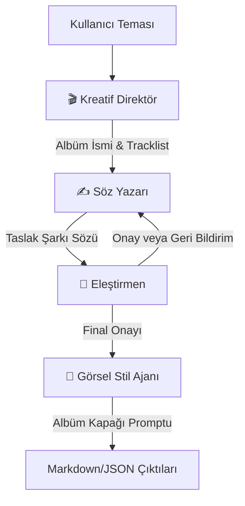

# STUDIOBASE 🎚️
> **Multi-Agent Music Concept & Lyrics Orchestrator**

STUDIOBASE, yapay zeka ajanlarının (AI Agents) işbirliği yaparak belirli bir tema etrafında tam kapsamlı bir müzik albümü konsepti, şarkı sözleri ve albüm kapağı sanatsal yönlendirmeleri tasarladığı **Çoklu Ajanlı (Multi-Agent) bir müzik motorudur**.

Arayüz tarafında modern, dokunsal ve profesyonel bir **Karanlık Neumorphism (Soft UI)** tasarım dili kullanılarak müzik stüdyolarındaki donanım synthesizer ve VST eklentileri tarzında bir görsel deneyim sunar.

---

## 🎬 Ajan Mimarisi (Multi-Agent Pipeline)

Projedeki iş akışı, ajanların birbirine veri aktardığı dinamik ve iteratif bir döngüden oluşur:



1. **🎬 Kreatif Direktör (Director)**: Kullanıcının belirlediği temayı alır, albüm ismine karar verir ve parça sayısı kadar şarkı başlığı planlar.
2. **✍️ Söz Yazarı (Lyricist)**: Belirlenen şarkıların mood ve başlıklarına uygun olarak şarkı sözlerinin ilk taslağını yazar.
3. **🎯 Eleştirmen (Critic)**: Taslak sözleri hece ölçüsü, kafiye, akıcılık ve sanatsal derinlik açısından inceler. Onay verene kadar (veya maksimum revizyon limitine ulaşılana kadar) Söz Yazarı'na geribildirim göndererek iterasyonu sürdürür.
4. **🎨 Görsel Stil Ajanı (Visual Agent)**: Albümün genel atmosferine uygun olarak Midjourney / DALL-E gibi araçlarda kullanılabilecek albüm kapağı promptu üretir.

---

## 🎨 Arayüz Tasarımı & Estetik

Arayüz, premium donanım hissini simüle eden **Dark Neumorphism** detaylarıyla donatılmıştır:
* **Neumorphic Gövde & Kumanda Paneli**: Kabartmalı (extruded) ve içe göçük (recessed) gölgelerin uyumuyla şekillenmiş mat yüzeyler.
* **Apple Tarzı Segmented Toggellar**: Sağlayıcı (Gemini / Ollama / Anthropic) ve Model seçimleri için yan yana kayan, pürüzsüz kapsül butonları.
* **Gömülü Konsol Ekranı (Live Agent Logs)**: Ajanlar arasındaki anlık konuşmaları, hece ölçümlerini ve karar süreçlerini gösteren, otomatik olarak en alta kayan neomorphic terminal ekranı.
* **Canlı Ajan Akış Diyagramı**: Hangi ajanın o an aktif olduğunu, iterasyon sayısını ve geri bildirim döngüsünü canlı olarak yansıtan şema.

---

## 💻 Teknoloji Yığını (Tech Stack)

* **Dil**: Python 3.10+
* **Arayüz (UI)**: Streamlit
* **Masaüstü Paketleme (Container)**: PyWebView (Streamlit sunucusunu Edge WebView2 ile çerçevesiz masaüstü penceresine gömer)
* **Büyük Dil Modelleri (LLMs)**:
  * **Google Gemini API** (Bulut çalıştırma - Ücretsiz & Hızlı: *Gemini 3.5 Lite*, *Gemini 3.6 Flash*)
  * **Ollama** (Yerel çalıştırma: *qwen2.5:7b*, *qwen2.5-coder:3b*)
  * **Anthropic API** (Bulut çalıştırma: *Claude Sonnet*, *Haiku*, *Opus*)

---

## 🚀 Kurulum ve Çalıştırma

### 1. Gereksinimlerin Yüklenmesi
Sanal ortamınızı oluşturduktan sonra kütüphaneleri yükleyin:
```powershell
pip install -r requirements.txt
```

### 2. Çevre Değişkenleri (`.env`)
Proje kök dizininde `.env` dosyası oluşturun (Örnek için bkz. `.env.example`):
```env
# Google Gemini API (Önerilen - Google AI Studio'dan Ücretsiz Key):
GEMINI_API_KEY=your_gemini_api_key_here

# Anthropic API kullanacaksanız:
ANTHROPIC_API_KEY=your_anthropic_api_key_here

# Varsayılan sağlayıcı ayarı ("gemini", "ollama" veya "anthropic")
LLM_PROVIDER=gemini
```

### 3. Uygulamanın Başlatılması

* **Masaüstü Uygulaması Olarak (Önerilen)**:
  ```powershell
  python launcher.py
  ```
  *Bu komut Streamlit'i arka planda başlatır ve pywebview ile doğrudan bir masaüstü uygulaması olarak ekranınıza getirir.*

* **Klasik Web Tarayıcısında**:
  ```powershell
  streamlit run app.py
  ```

* **Terminal (CLI) Üzerinden**:
  ```powershell
  python main.py --theme "Cyberpunk Melankoli" --tracks 4 --max-iterations 3 --provider gemini
  ```
  *Çıktılar `./output` klasörüne `.md` ve `.json` formatında kaydedilir.*
